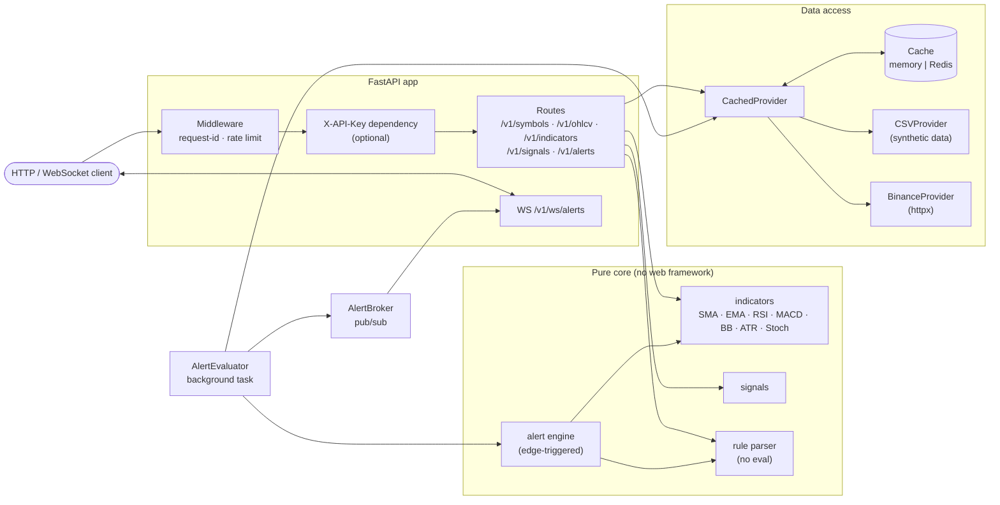

# market-pulse-api

[](https://github.com/ariaesm/market-pulse-api/actions/workflows/ci.yml)
[](LICENSE)
[](pyproject.toml)

A FastAPI service for market data. It serves OHLCV candles, computes technical
indicators, evaluates alert rules you define, and streams triggered alerts over
WebSocket.

The indicators are written from scratch on numpy/pandas and checked against values
worked out by hand. Alert rules use a small expression language with its own parser,
so nothing goes through `eval()`. Data sources plug in behind one interface. The repo
ships with synthetic data, so it runs offline out of the box.

> **Not financial advice.** This is an engineering project. Signals and alerts are
> simple heuristics for educational use. The bundled data is synthetic and contains
> no real prices.

## Features

- **Market data:** `GET /v1/symbols` and `GET /v1/ohlcv/{symbol}` across pluggable providers:
  - `CSVProvider` reads the bundled synthetic CSVs in [`data/`](data/README.md).
  - `BinanceProvider` calls the public Binance klines REST API with async `httpx`.
- **Indicators** computed from scratch: SMA, EMA, RSI (Wilder), MACD, Bollinger Bands,
  ATR (Wilder) and Stochastic. Extra warm-up bars are fetched so the values you get back
  are fully formed.
- **Signals:** RSI oversold/overbought, EMA(9/21) cross and Bollinger breakout, plus a
  simple overall bias.
- **Alert rules** such as `rsi_14 < 30 and close > 50000`:
  - A safe recursive-descent parser handles them, with `and`/`or` and parentheses.
  - Each rule fires once when it changes from false to true (edge-triggered).
- **Live alerts:** a background evaluator checks the rules on a timer and pushes
  triggered alerts to WebSocket subscribers on `WS /v1/ws/alerts`.
- **Caching:** an in-memory TTL/LRU cache by default, or Redis (`redis.asyncio`).
  A cache outage never fails a request.
- **Production basics:**
  - Settings come from environment variables.
  - Logs are structured JSON, and every response carries an `X-Request-ID`.
  - All errors use one consistent JSON envelope.
  - Requests are validated.
  - Optional `X-API-Key` auth and token-bucket rate limiting are included.
- **OpenAPI docs** at `/docs` and `/redoc`, with tags and examples.
- **Deployment:** a multi-stage Docker image that runs as a non-root user and has a
  healthcheck, plus `docker compose` with Redis and GitHub Actions CI.

## Architecture



The domain logic (indicators, rule parser, alert engine, cache, rate limiter, provider
parsing) does not import FastAPI, httpx or redis, so it can be tested in isolation.
The web layer only wires things together.

## Quickstart

### Docker Compose (API + Redis)

```bash
docker compose up --build
# API:  http://localhost:8000
# Docs: http://localhost:8000/docs
```

### Local (Python 3.11+)

```bash
python -m venv .venv && source .venv/bin/activate
pip install -e ".[dev,redis]"
uvicorn market_pulse.main:app --reload
```

To use live Binance data instead of the synthetic CSVs:

```bash
MP_DATA_PROVIDER=binance MP_BINANCE_SYMBOLS=BTCUSDT,ETHUSDT uvicorn market_pulse.main:app
```

## Usage examples

```bash
# Health and symbols
curl -s localhost:8000/health
curl -s localhost:8000/v1/symbols

# Last 5 hourly candles
curl -s "localhost:8000/v1/ohlcv/BTCUSDT?interval=1h&limit=5"

# Indicators (columns: rsi_14, ema_20, macd, macd_signal, macd_hist, bb_*_20, atr_14)
curl -s "localhost:8000/v1/indicators/BTCUSDT?names=rsi,ema_20,macd,bbands,atr&limit=3"

# Rule-based signals on the latest bar
curl -s localhost:8000/v1/signals/ETHUSDT

# Create, list and delete an alert rule
curl -s -X POST localhost:8000/v1/alerts \
  -H 'Content-Type: application/json' \
  -d '{"symbol": "BTCUSDT", "interval": "1h", "expression": "rsi_14 < 30 or close > 70000", "name": "BTC watch"}'
curl -s localhost:8000/v1/alerts
curl -s -X DELETE localhost:8000/v1/alerts/<id>

# With auth enabled (MP_API_KEYS=secret)
curl -s -H 'X-API-Key: secret' localhost:8000/v1/symbols
```

### WebSocket

```bash
# using websocat (https://github.com/vi/websocat)
websocat "ws://localhost:8000/v1/ws/alerts?symbol=BTCUSDT"
```

```python
import asyncio
import json

import websockets


async def main() -> None:
    async with websockets.connect("ws://localhost:8000/v1/ws/alerts") as ws:
        async for message in ws:
            print(json.loads(message))


asyncio.run(main())
```

The first message confirms the subscription. Triggered alerts follow:

```json
{"type": "subscribed", "symbol": "BTCUSDT"}
{"type": "alert.triggered", "alert_id": "6f1c...", "name": "BTC watch", "symbol": "BTCUSDT",
 "interval": "1h", "expression": "rsi_14 < 30 or close > 70000",
 "values": {"rsi_14": 28.4, "close": 61234.5},
 "bar_time": "2025-02-11T15:00:00+00:00", "triggered_at": "2026-01-01T12:00:00+00:00"}
```

## API

| Method | Path | Description |
| --- | --- | --- |
| `GET` | `/health` | Liveness and component status (no auth, no rate limit) |
| `GET` | `/v1/symbols` | Symbols and intervals from the active provider |
| `GET` | `/v1/ohlcv/{symbol}?interval=&limit=` | OHLCV candles, oldest first |
| `GET` | `/v1/indicators/{symbol}?names=&interval=&limit=` | Indicator values aligned to candles |
| `GET` | `/v1/signals/{symbol}?interval=` | Rule-based signals on the latest bar |
| `POST` | `/v1/alerts` | Create an alert rule |
| `GET` | `/v1/alerts?symbol=` | List alert rules |
| `DELETE` | `/v1/alerts/{id}` | Delete an alert rule |
| `WS` | `/v1/ws/alerts?symbol=&api_key=` | Stream triggered alerts |

**Intervals:** `1m 5m 15m 1h 4h 1d`. The bundled CSV data has `1h` and `1d`.

**Indicator specs** (`names=`): `sma_N`, `ema_N`, `rsi[_N]`, `macd`, `bbands[_N]`,
`atr[_N]`, `stoch[_N]`.

**Rule identifiers:** any indicator output column (`rsi_14`, `ema_50`, `macd_hist`,
`bb_upper_20`, `stoch_k_14`, `atr_14`, ...) or a price field (`open`, `high`, `low`,
`close`, `volume`).

**Rule grammar:**

```
expr       := and_expr ("or" and_expr)*
and_expr   := term ("and" term)*
term       := comparison | "(" expr ")"
comparison := IDENT ("<" | "<=" | ">" | ">=" | "==" | "!=") NUMBER
```

**Errors** always use the same envelope:

```json
{"error": {"code": "symbol_not_found", "message": "unknown symbol 'DOGEUSDT'", "details": {}}}
```

## Configuration

All settings come from environment variables with the `MP_` prefix (see
[`.env.example`](.env.example)).

| Variable | Default | Description |
| --- | --- | --- |
| `MP_ENVIRONMENT` | `development` | `development`, `production` or `test` |
| `MP_LOG_LEVEL` | `INFO` | Log level |
| `MP_LOG_JSON` | `true` | JSON logs (`false` for plain text) |
| `MP_DATA_PROVIDER` | `csv` | `csv` or `binance` |
| `MP_DATA_DIR` | `./data` | Directory of `<SYMBOL>_<interval>.csv` files |
| `MP_BINANCE_BASE_URL` | `https://api.binance.com` | Binance REST base URL |
| `MP_BINANCE_SYMBOLS` | `BTCUSDT,ETHUSDT,SOLUSDT` | Symbols exposed by the Binance provider |
| `MP_PROVIDER_TIMEOUT_SECONDS` | `10` | Upstream HTTP timeout |
| `MP_CACHE_BACKEND` | `memory` | `memory` or `redis` |
| `MP_REDIS_URL` | `redis://localhost:6379/0` | Redis connection URL |
| `MP_CACHE_TTL_SECONDS` | `30` | OHLCV cache TTL |
| `MP_CACHE_MAX_ENTRIES` | `1024` | Max entries for the memory cache |
| `MP_API_KEYS` | *(empty)* | Comma-separated keys; empty disables auth |
| `MP_RATE_LIMIT_ENABLED` | `true` | Enable the token-bucket rate limiter |
| `MP_RATE_LIMIT_PER_MINUTE` | `120` | Sustained requests per minute per client |
| `MP_RATE_LIMIT_BURST` | `30` | Bucket capacity (burst size) |
| `MP_ALERT_EVAL_ENABLED` | `true` | Run the background alert evaluator |
| `MP_ALERT_EVAL_INTERVAL_SECONDS` | `15` | Evaluation period |
| `MP_ALERT_LOOKBACK` | `300` | Bars fetched per series for evaluation |
| `MP_DEFAULT_LIMIT` | `200` | Default `limit` for candle endpoints |
| `MP_MAX_LIMIT` | `1000` | Upper bound for `limit` |

## Project structure

```
market-pulse-api/
├── src/market_pulse/
│   ├── indicators/      # core.py (pure math) + registry.py (spec parsing)
│   ├── rules/           # safe alert-rule tokenizer/parser/AST
│   ├── alerts/          # AlertRule model, in-memory store, edge-triggered engine
│   ├── providers/       # ABC, CSVProvider, BinanceProvider, CachedProvider
│   ├── cache/           # Cache protocol, memory TTL/LRU, Redis
│   ├── api/             # FastAPI app factory, routes, schemas, middleware, errors
│   ├── signals.py       # rule-based signals
│   ├── evaluator.py     # background alert evaluation loop
│   ├── streaming.py     # pub/sub broker for WebSocket fan-out
│   ├── ratelimit.py     # token bucket
│   ├── config.py        # env-driven settings
│   ├── log.py           # JSON logging
│   └── main.py          # ASGI entry point
├── tests/               # pytest suite
├── data/                # SYNTHETIC OHLCV CSVs
├── scripts/             # synthetic data generator
├── Dockerfile
├── docker-compose.yml
└── .github/workflows/ci.yml
```

## Testing

```bash
make test        # or: PYTHONPATH=src python -m pytest
make lint        # ruff check + ruff format --check
```

The pure-logic tests need only numpy, pandas and pydantic:

- indicators checked against hand-computed values
- the rule parser, including rejection of unsafe input
- the alert engine, cache, rate limiter, providers (with a mocked HTTP client),
  broker and evaluator

The HTTP and WebSocket tests in `tests/test_api.py` call `pytest.importorskip` for
`fastapi` and `httpx`. They skip in environments without those packages and run in CI.

## Roadmap

- Persistent alert storage (SQLite/Postgres) and per-key ownership of rules
- Redis pub/sub broker and Redis-backed rate limiting for multi-instance deployments
- Binance WebSocket kline streaming instead of polling
- More indicators (VWAP, OBV, ADX, Ichimoku) and crossover operators in rules
  (`ema_9 crosses_above ema_21`)
- Webhook / Telegram delivery for triggered alerts
- Prometheus metrics endpoint

## Contributing

See [CONTRIBUTING.md](CONTRIBUTING.md).

## License

[MIT](LICENSE) © 2026 Aria Esmaeilzadeh
